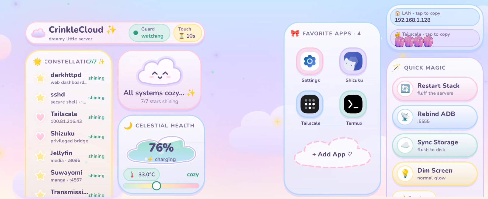

# ☁️ CrinkleCloud ✨

> A dreamy, pastel landscape launcher & 24/7 server watchdog for Android nodes.

<p align="center">
  
</p>

<p align="center">
  <b>Package:</b> <code>one.crinklecod.cc</code> &nbsp;•&nbsp;
  <b>Form Factor:</b> Locked Landscape / Desk Dock Display &nbsp;•&nbsp;
  <b>Theme:</b> Dreamy Kawaii Pastel
</p>

---

## 🌸 Features

* ☁️ **Dreamy Cloudscape UI**: Edge-to-edge organic pillowy cards, soft floating animations, starry twilights, and pastel glowing indicators.
* 🔋 **Fluffy Cloud Battery Meter**: Live battery charge percentage, charging status, and thermal monitoring with gentle color cues.
* ✨ **Celestial Service Constellation**: Live port and health checks for:
  * `darkhttpd` (:8000)
  * `sshd` (:8022)
  * `jellyfin` (:8096)
  * `suwayomi` (:4567)
  * `transmission` (:9091)
  * `ADB TCP` (:5555)
  * `Shizuku` privileged API
* 🧸 **Quick Actions Bar**: Single-tap stack restart (`~/restart-services.sh`), ADB TCP cycling, survival re-binding, and display sleep controls.
* 🛡️ **Touch Shield (Touch Blocker)**: Transparent overlay lock with a quick-tap temporary pause for easy interactions without taking the phone out of dock mode.
* 🎀 **Favorite Apps Launcher**: Bouncy pastel launcher deck with monogram badges and a cloud-shaped *+ Add App* dialog.
* ☕ **24/7 Survival Watchdog**: Foreground service holding low-power wake locks and Wi-Fi locks with zero-touch boot receiver.

---

## 🚀 Quick Setup

### 1. Build and Install
```bash
./gradlew installDebug
```

### 2. Provision with ADB
Run the setup script to grant background permissions, exempt from Doze, and start the service:
```bash
./setup-razrguard.sh
```

---

## 🌐 GitHub Pages
Visit the live showcase site at: [https://smolstinkyprincess.github.io/crinklecloud/](https://smolstinkyprincess.github.io/crinklecloud/)

---

## 💖 Credits & License
Created with ♡ by **crinklecod**. Licensed under the [MIT License](LICENSE).
